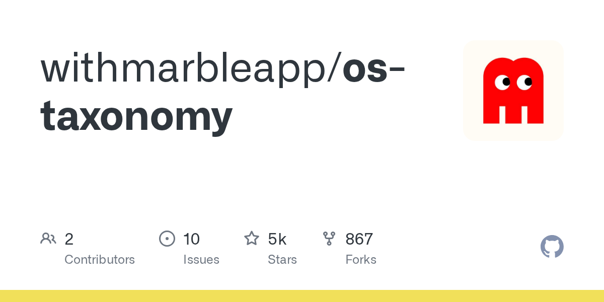

# withmarbleapp/os-taxonomy · 2026-10-17

1. **[withmarbleapp/os-taxonomy](https://github.com/withmarbleapp/os-taxonomy)** ⭐ 5.2k · JavaScript
   - 上方的可视化图例中，每个点都是一个微主题，按学科着色；高度代表年龄；每条线代表一个前置依赖关系。你可以在 withmarble.com/curriculum 进行交互式探索——点击任意概念，即可追踪学习者在达到该概念前必须掌握的所有内容。
   - [deepwiki](https://deepwiki.com/withmarbleapp/os-taxonomy) · [zread](https://zread.ai/withmarbleapp/os-taxonomy) · [codewiki](https://codewiki.google/github.com/withmarbleapp/os-taxonomy)

   

---
由 daily-digest bot 自动生成
